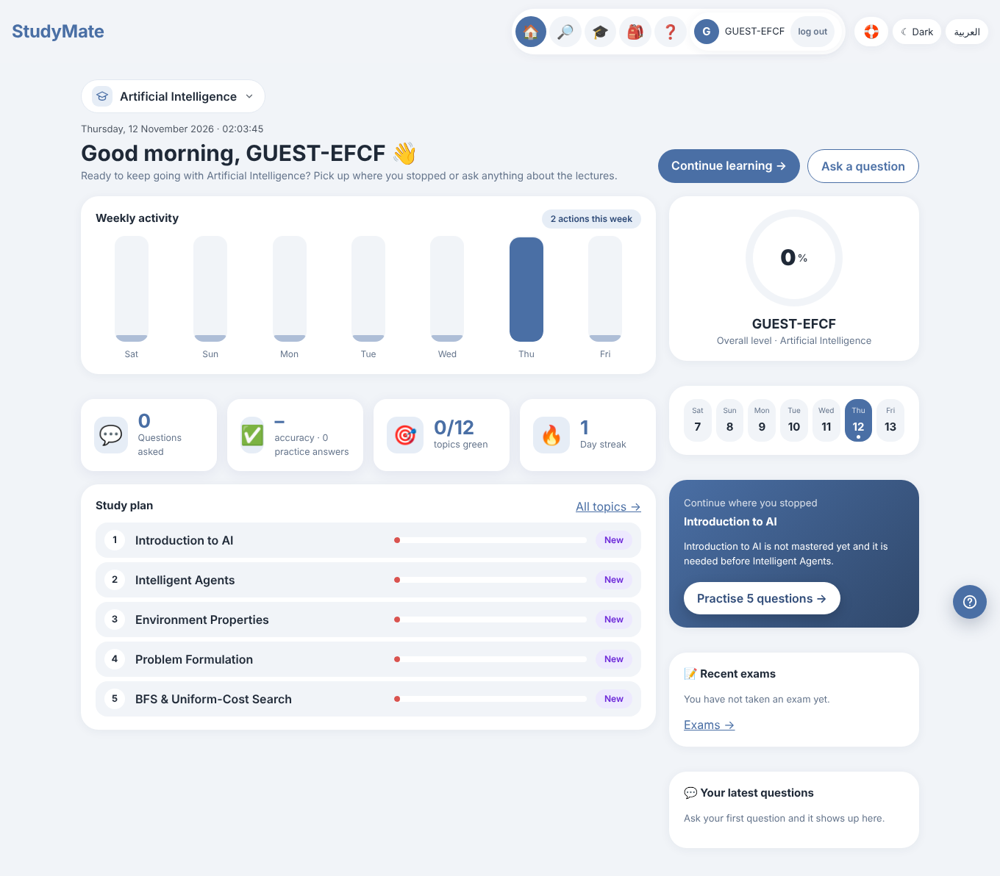
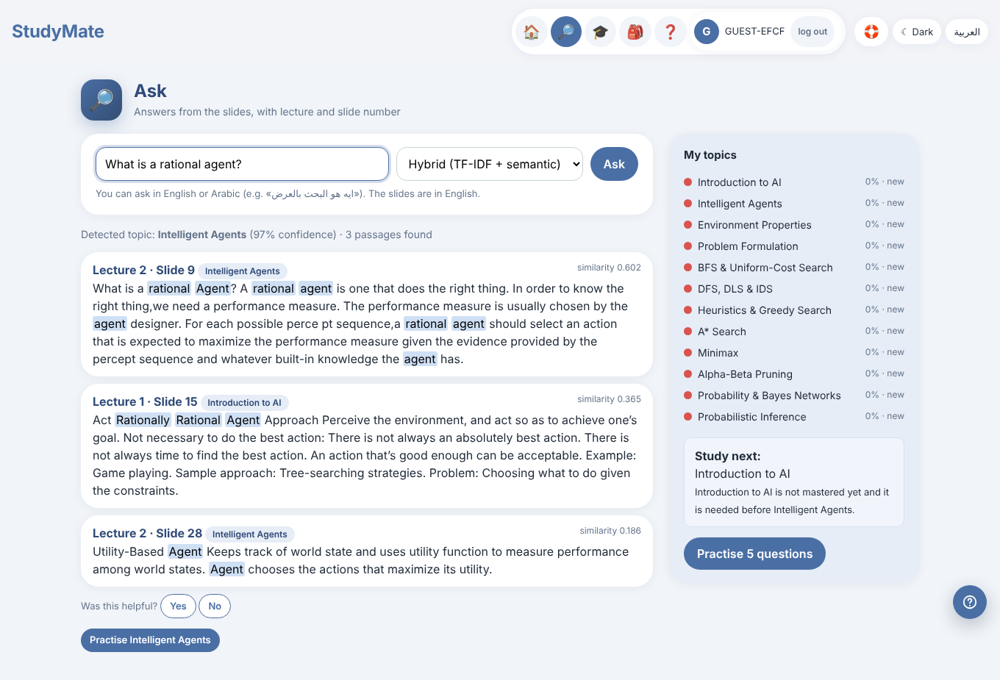
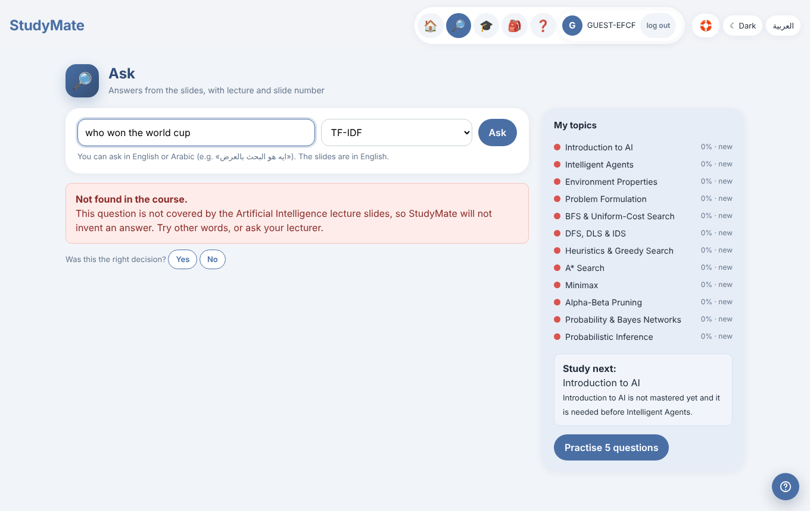
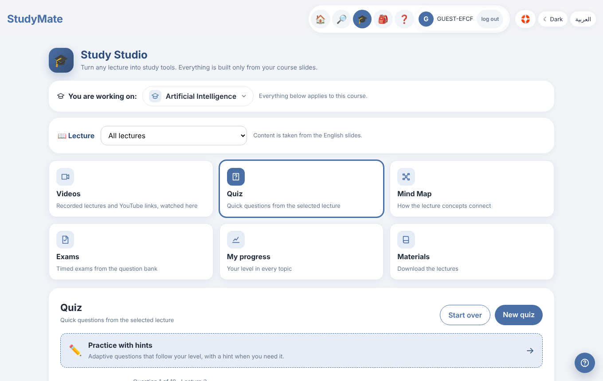
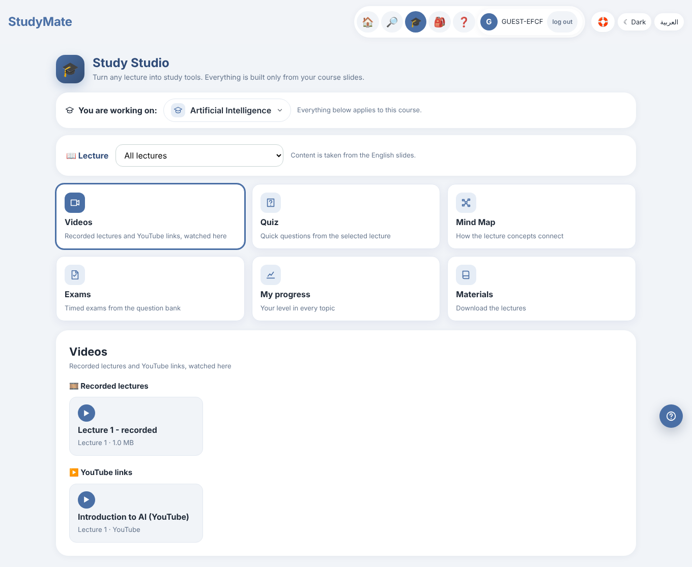
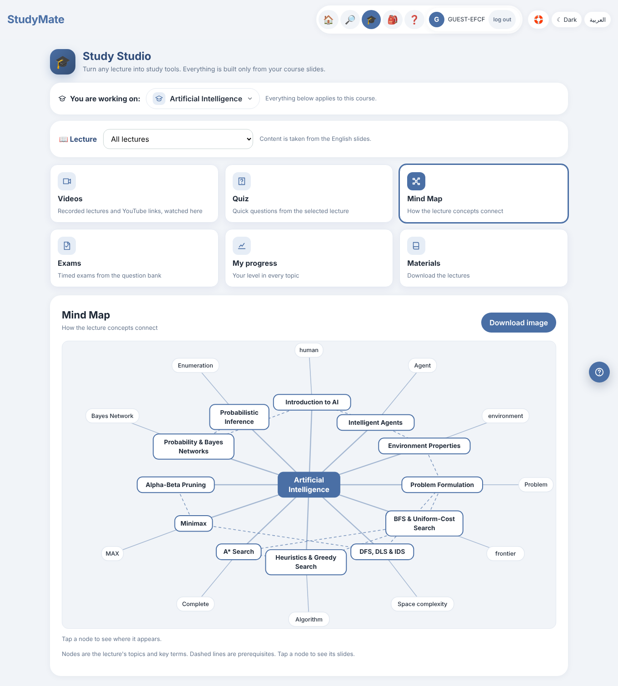
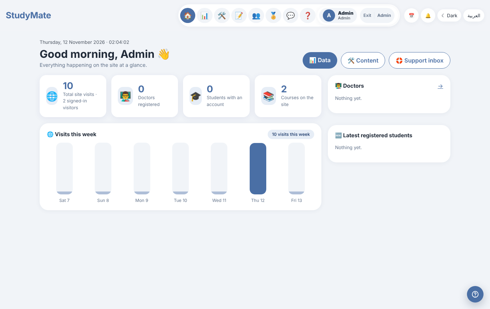
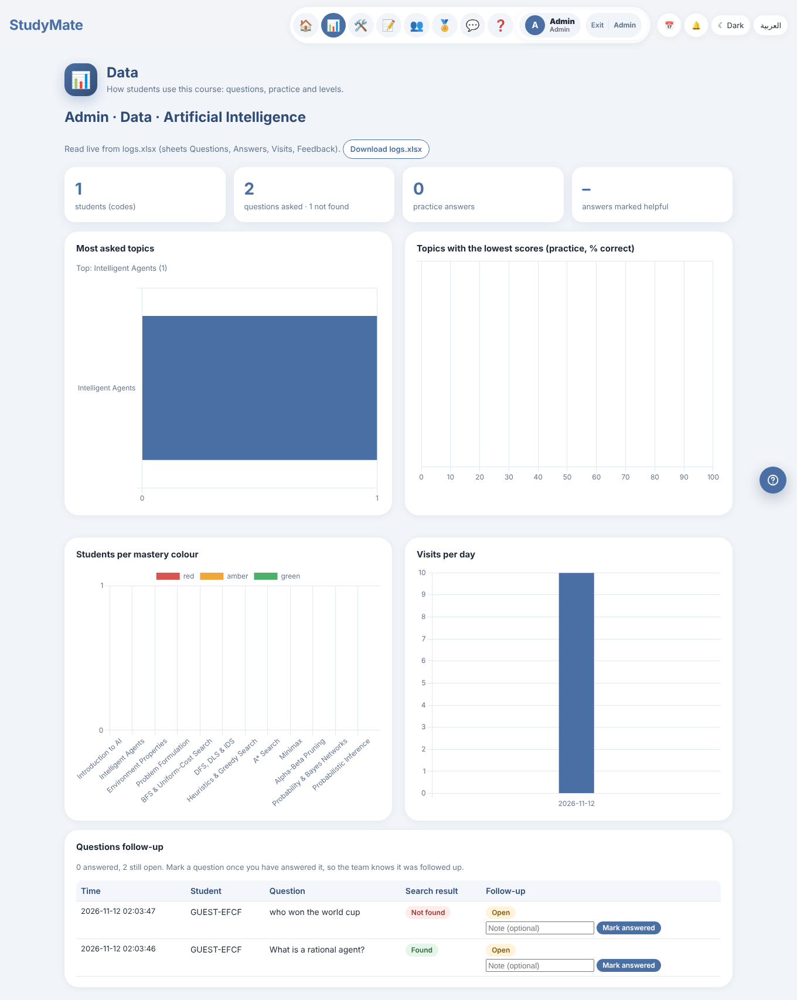
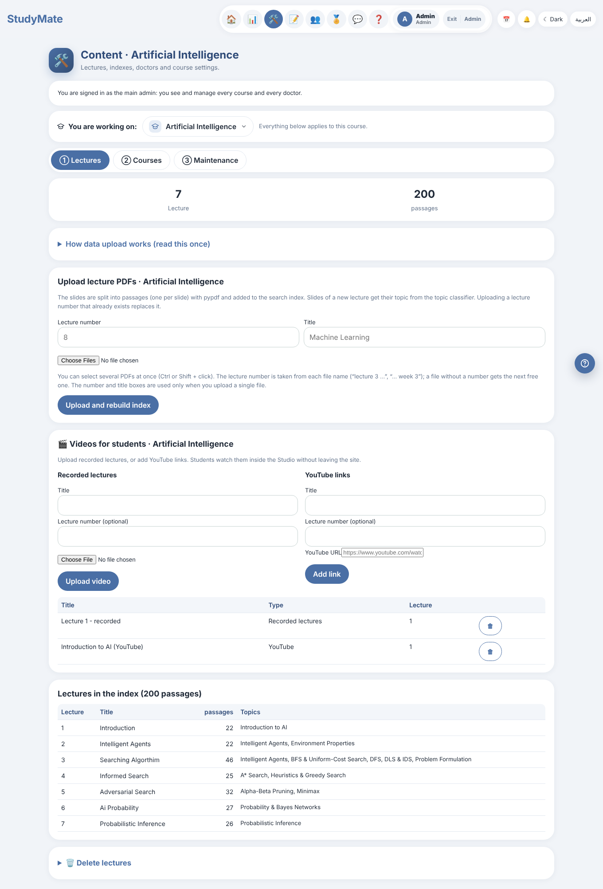
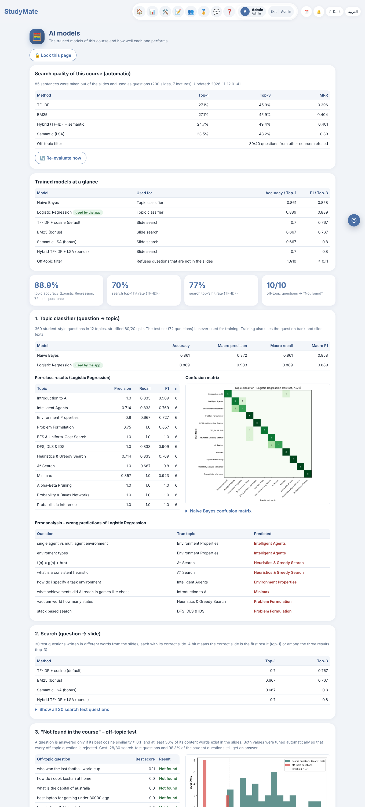

# StudyMate — Course Study Assistant

**AI Lab · Project 1E** · Benha University, Faculty of Engineering (Mechatronics, Systems & AI Automation)
Live demo: <https://ahmedhallawa.pythonanywhere.com> · Code: <https://github.com/pikachu8240/StudyMate>

StudyMate answers a student's question **only from the course's own lecture slides** and always shows the lecture and slide number.
If the question is not in the course it says **"Not found in the course"** instead of inventing an answer. Around that core it gives students
a study area (quiz, mind map, videos, exams, progress, badges), and gives doctors tools to upload lectures, follow students' questions and see how well the search works.
English and Arabic (RTL), light/dark theme, works on phones.

| Student home | Ask (answer from slides) | Not found |
|---|---|---|
|  |  |  |

## What it does

**Students** — register (or continue as guest) · ask in English or Arabic · choose the search method · detected topic + confidence · "was this helpful?" ·
**Study Studio**: Quiz, Mind Map (course as root), Videos (recorded lectures + YouTube played *inside* the site), links to Exams / Progress / Materials ·
mastery per topic and "study next" · 25 badges · ready exams (timed, auto-graded, essay similarity) · calendar & notifications · direct chat · Help/FAQ on every page ·
delete my account.

| Study Studio | Videos | Mind map |
|---|---|---|
|  |  |  |

**Doctors / admin** — upload lecture PDFs (a new course is built automatically: passages, topics, glossary, question bank, search index) ·
several courses and several doctors (each doctor sees only his own students) · **questions follow-up** (every question is *Open* or *Answered*, with a note) ·
upload recorded lectures / YouTube links · exam builder, scheduling, results · dashboard & Excel export · FAQ editor ·
password-protected **AI models** page.

| Overview | Questions follow-up | Content & videos |
|---|---|---|
|  |  |  |

## The AI part

| Component | Method |
|---|---|
| Slide search | **TF-IDF**, **BM25**, **LSA** (TruncatedSVD, semantic), **Hybrid** (0.5 TF-IDF + 0.5 LSA); optional free **Neural** method (`fastembed`, see `requirements-optional.txt`) |
| "Not found" gate | similarity threshold + query-word coverage, tuned on an off-topic test set |
| Topic classifier | TF-IDF + Logistic Regression / Naive Bayes |
| Arabic questions | glossary-based translation to the slides' English terms |
| Mastery | per-topic level updated after each answer → "study next" |
| Auto-evaluation | hold-out sentences (one sentence per slide removed from the index and used as the question) for all methods; re-run after every upload / rebuild / retrain, so the percentages change with the course |
| Studio | extractive summaries, cloze questions, key-term mind map — no LLM, nothing invented |

The **AI models** page (admin → profile → unlock with the models password) shows the four methods' Top-1 / Top-3 / MRR, the off-topic test and the history:



### Colab notebooks
| Notebook | |
|---|---|
| Search-model training & evaluation (TF-IDF / BM25 / Hybrid / LSA + topic classifier; upload your own PDFs) | [Open in Colab](https://colab.research.google.com/github/pikachu8240/StudyMate/blob/main/notebooks/StudyMate_Search_Models.ipynb) |
| Lecture-image recognition (extract images from PDFs → CNN → image-to-slide search) | [Open in Colab](https://colab.research.google.com/github/pikachu8240/StudyMate/blob/main/notebooks/StudyMate_Image_Recognition.ipynb) |

## Run it locally
```bash
git clone https://github.com/pikachu8240/StudyMate.git && cd StudyMate
python -m venv venv && source venv/bin/activate        # Windows: venv\Scripts\activate
pip install -r requirements.txt
python app.py                                          # http://127.0.0.1:5000
```
The trained models are included, so it works right away. Rebuild from the PDFs: `python scripts/build_passages.py && python scripts/train.py && python scripts/evaluate.py`.
Tests: `python -m pytest -q` (69 tests).

**Before putting it online set these environment variables** (the defaults are for development only):

| Variable | Purpose |
|---|---|
| `LECTURER_PASSWORD` | password of the main admin (**required** in production) |
| `SECRET_KEY` | signs login sessions (**required** in production) |
| `STUDYMATE_MODELS_PASSWORD` | password of the AI-models page (optional; falls back to the admin password) |
| `STUDYMATE_TZ` | time zone, default `Africa/Cairo` |
| `BREVO_API_KEY`+`MAIL_FROM`, or `RESEND_API_KEY`+`MAIL_FROM`, or `SMTP_*` | e-mail for passwords/notifications (optional) |
| `SHEET_SYNC=1`, `GOOGLE_SHEET_ID`, `GOOGLE_SERVICE_ACCOUNT_FILE` | Google Sheet mirror (optional) |
| `STUDYMATE_NEURAL=0` | turn the optional neural method off |

Step-by-step hosting guides: [docs/DEPLOY.md](docs/DEPLOY.md) · what to hand over / what never to share: [docs/HANDOVER.md](docs/HANDOVER.md).

## Project layout
```
app.py            Flask routes            core/        search, studio, exams, accounts, videos, autoeval, i18n …
templates/ static/  UI (Jinja, CSS, JS)   scripts/     build_passages, train, evaluate
data/<COURSE>/    lectures (PDF), passages.csv, topics, question bank, glossary
models/           trained search index and topic classifiers
notebooks/        Colab notebooks         tests/       automated tests
```
Runtime data (accounts, logs, videos, follow-ups, password hashes) is created on first run and is **git-ignored**.

## Known limits
* Slide *text* only: pictures inside slides are not searchable yet (the image notebook is the first step).
* Scanned PDFs rely on OCR and are noisier (e.g. MAM336).
* Free PythonAnywhere: no outbound internet except an allow-list (so no neural model download, no e-mail API), 512 MB disk, app must be renewed monthly.
* The log store is SQLite (`logs.db`, one row added per event, safe for many users at the same time). The old `logs.xlsx` is imported once, automatically, the first time the site starts; the Dashboard's “Download logs.xlsx” builds an Excel file from the database.
* The chat assistant (the round button at the bottom corner) is layer 1: an intent router that needs no AI service. It sends each message to the right page, and course questions to the slide search. Layer 2 (a free LLM) can plug in at `core/assistant.py: fallback()`.
